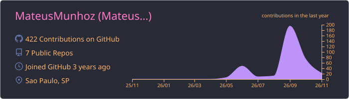
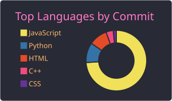
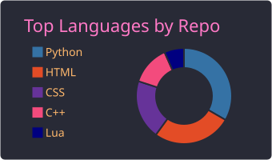
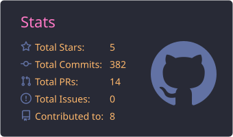
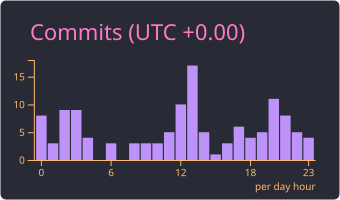

  

  
  

Estudante de <b>Ciência da Computação na PUC-SP</b> (3º ano, formatura prevista para dez/2027), em busca de <b>estágio em desenvolvimento de software</b>, presencial ou remoto, com disponibilidade imediata.

Gosto de problemas que misturam lógica, estruturas de dados e sistemas de baixo nível, e de transformar isso em ferramentas que funcionam de verdade.

## Tecnologias

  
  
  
  
  
  
  
  
  

## Projetos em destaque

  
  
  

- **AMS2-Telemetry-Overlay** · Python, PyQt5, ctypes, JSON *(em desenvolvimento)*: overlay transparente e click-through que lê a memória compartilhada do Automobilista 2 e mostra pedais, marcha, velocidade, RPM e tempos de volta em tempo real, com gráficos do histórico de entradas, widgets reposicionáveis e atalhos globais.
- **Screen-Capture** · Python, Tkinter, Pillow, pynput, MSS: ferramenta semiautomática de captura de tela que organiza screenshots por mapa e ponto de surgimento, para montar um dataset de treinamento de uma rede neural em Escape from Tarkov.
- **portfolioOnline** · HTML, CSS, JavaScript: meu portfólio web responsivo, com animações em JavaScript, apresentando meus projetos.

## Atividade

  

## GitHub Summary Cards

  

  
  

  
  

## Contato

- E-mail: [mateusimunhoz@hotmail.com](mailto:mateusimunhoz@hotmail.com)
- LinkedIn: [Mateus Munhoz Guimarães](https://www.linkedin.com/in/mateus-munhoz-guimar%C3%A3es-606436278/)
- Idiomas: português nativo, inglês fluente
